# Architecture and execution flow

```mermaid
flowchart LR
    Hotkey[Ctrl+Alt+X recorder] --> ASR[Local ASR]
    Text[Typed text] --> Entry[Shared task entry]
    ASR --> Entry
    Entry --> Registry[Application Registry SQLite + approved aliases]
    Registry -->|unresolved| Retrieve[FTS5 and CPU BGE candidate search]
    Retrieve -->|still unresolved| Web[Read-only web name check]
    Registry -->|approved target| Model[Local Qwen text model]
    Web -->|unique approved target| Model
    Model --> Hermes[Hermes command/tool router]
    Hermes --> Launch[Windows launch broker]
    Hermes --> OCR[Local OCR first]
    OCR -->|text absent or ambiguous| Vision[ModelScope vision API]
    OCR --> Click[Scoped desktop click]
    Vision --> Click
    Launch --> Verify[Process and visible-window verification]
    Click --> Verify
    Verify --> Feedback[Result, reason, task journal]
```

The registry, not a web result, owns executable paths and approval state.
Web results offer name evidence only. The visual API never supplies a program
path. The local text model and Hermes stay ordinary privilege; elevated desktop
actions are scoped to an approved target and independently verified.

## Modules

| Module | Responsibility |
| --- | --- |
| `services/voice_hotkey.py` | Hotkey, recording UI, countdown, audio handoff |
| `scripts/transcribe-hotkey-recording.py` | Local ASR for one recording |
| `services/task_entry.py` | Action gate, cancellation, state journal, orchestration |
| `services/application_registry.py` | Approved app identity, paths, aliases, conflict review, FTS5 |
| `services/semantic_candidates.py` | Optional CPU BGE + FAISS candidates |
| `services/web_alias_resolution.py` | Read-only web fallback for unknown app names |
| `services/local_openai_api.py` | Local Qwen text-model endpoint |
| Hermes runtime | Model-directed tool calls; installed separately |
| `services/app_launch_broker.py` | Local launch and real process/window status |
| `scripts/local-ocr.py` | CPU text location |
| `scripts/vision-locate.py`, `services/modelscope_vision.py` | Screenshot understanding and fallback location |
| `services/vision_desktop_mcp.py` | Scoped desktop tools exposed to Hermes |

The installer preview checks prerequisites and does not install or activate
models. No deletion/uninstall workflow is included in this release.
